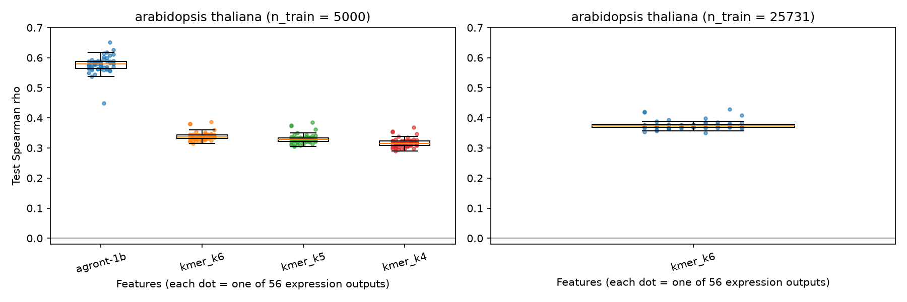

# Do plant DNA language models beat k-mers at predicting gene expression?

[](https://github.com/Olaraym/plant-dnalm-expression/actions/workflows/ci.yml)

**Question.** How well do *frozen* embeddings from pretrained plant DNA language models predict tissue-level
gene expression from a gene's 6 kb regulatory sequence, compared with a simple k-mer frequency baseline?

**Why it matters.** Language models are increasingly used to score regulatory variants and design sequences
for crops. A model is only useful for that if it captures more than a k-mer count already does.

**Status:** v0.1 in progress (two-week sprint, Nov 23 – Dec 6, 2026). See [PLAN.md](PLAN.md).

## Data

| Dataset | Source | Citation | License |
| --- | --- | --- | --- |
| Plants Genomic Benchmark, gene expression task (6 kb sequences, multi-output regression; fixed train/valid/test splits per species) | [InstaDeepAI/plant-genomic-benchmark](https://huggingface.co/datasets/InstaDeepAI/plant-genomic-benchmark) | Mendoza-Revilla et al. (2024) *Communications Biology* | CC-BY-NC-SA-4.0 |

Start species: *Arabidopsis thaliana* (the smallest gene-expression task). Raw data are not committed;
`make data` downloads them and prints the label layout.

## Models compared

All feature sets go through **the same ridge-regression head**, with the penalty chosen on the validation
split, so differences in test scores come from the features alone.

| Features | What it is | Dimensions |
| --- | --- | --- |
| k-mer (k = 4, 5, 6) | normalized k-mer frequencies | 256 / 1,024 / 4,096 |
| PlantCaduceus (frozen) | Mamba-based DNA LM pre-trained on 16 angiosperm genomes ([Zhai et al. 2024](https://www.biorxiv.org/content/10.1101/2024.06.04.596709)); mean-pooled over 512 bp windows | model hidden size |
| AgroNT (frozen, optional) | 1B-parameter transformer pre-trained on 48 plant genomes ([Mendoza-Revilla et al. 2024](https://doi.org/10.1038/s42003-024-06465-2)); one 6 kb window | model hidden size |

Metrics on the held-out test split, per expression output and averaged: Pearson r, Spearman ρ, R².

## Results

_To be filled in after the runs._

| Features | n train | Mean Spearman ρ (test) | Mean Pearson r (test) | Mean R² (test) |
| --- | --- | --- | --- | --- |
| k-mer k=6 | 5,000 | | | |
| PlantCaduceus-l20 (frozen) | 5,000 | | | |



**Interpretation notes.** Frozen, mean-pooled embeddings throw away position information and are not trained
for this task, so they can lose to k-mers. That would be a real finding, not a failure. The published AgroNT
results come from *fine-tuning*, so they are an upper reference, not a like-for-like comparison.

## Reproduce

```bash
git clone https://github.com/Olaraym/plant-dnalm-expression.git
cd plant-dnalm-expression
make env && conda activate plant-dnalm-expression
make test                      # unit tests + offline end-to-end run on synthetic data
make data                      # download the Arabidopsis task and print its layout
make baseline MAX_TRAIN=5000   # k-mer baselines (CPU, a few minutes)
```

Embedding extraction needs a GPU. Open
[`notebooks/colab_extract_embeddings.ipynb`](notebooks/colab_extract_embeddings.ipynb) in Google Colab
(T4 GPU), run all cells, then unzip the outputs into this folder and run `make compare`.

## Layout

```
src/pgb.py        download + parse PGB FASTA files (labels in '|'-separated headers)
src/kmers.py      k-mer frequency features
src/embed.py      windowing, pooling and frozen-model embedding extraction
src/evaluate.py   shared ridge head (alpha chosen on validation) and metrics
scripts/          command-line steps (download, baseline, embeddings, ridge, compare, synthetic data)
notebooks/        Colab notebook for the GPU step
tests/            pytest suite, including an end-to-end run on synthetic motif-driven data
```

## Author

Laide A. Rasaki · NC State University · [ORCID 0000-0002-5594-6827](https://orcid.org/0000-0002-5594-6827)
AI assistance is documented in [AI_ASSISTANCE.md](AI_ASSISTANCE.md).
